Hey! I'm Russel.

Currently building SHUKIYO. 
Work with us: [shukiyo.com/freelance](https://shukiyo.com/freelance)

Pursuing a bachelor's in Software Engineering at UTD. 

Developer with contributions to experiences totaling 500M+ plays, including a 2025 RIA nominee.  
I build scalable mechanics that run across console, mobile, and PC. 
Additional experience in environmental design and 3D art: sculpting, hard-surface modeling, rigging and animation, texturing.  
I have a particular interest in blending sound design with mechanics to improve immersion and emotional response.

Languages/Programs I work with:

  
  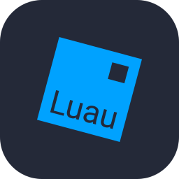
  
  
  
  
  
  
  
  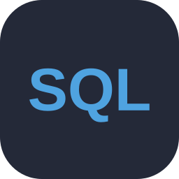
  
  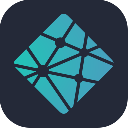
  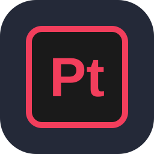
  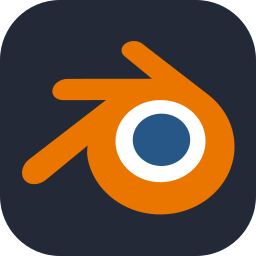
  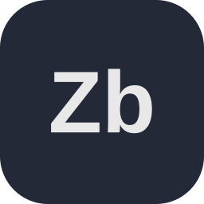
  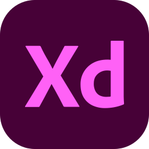
  
  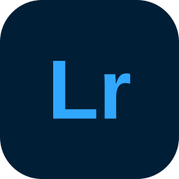
  
  
  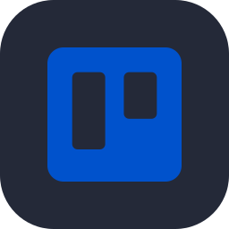
  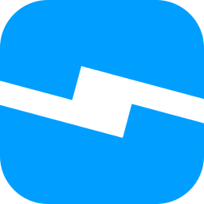
  
  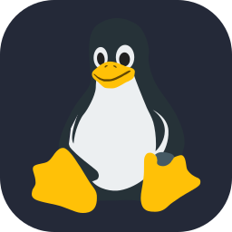
  
  

